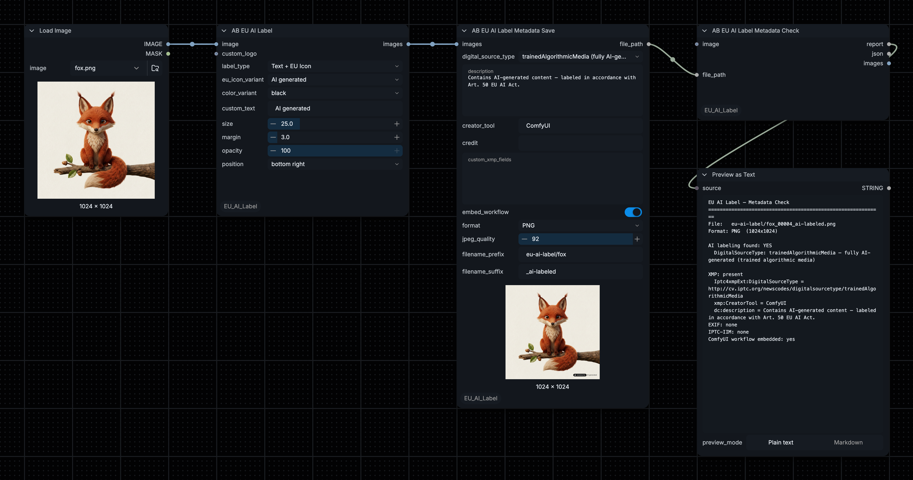

<div align="center">

# AB EU AI Label: label AI images per Art. 50 EU AI Act in ComfyUI

**The official EU AI icon in the image and machine-readable AI metadata in the file, as the last step of every generation.**

<br />

[](https://github.com/a-und-b/ComfyUI_EU_AI_Label/stargazers)
&nbsp;
[](https://registry.comfy.org/nodes/eu_ai_label)
&nbsp;
[](https://registry.comfy.org/nodes/eu_ai_label)
&nbsp;
[](LICENSE)

<br />



---

Since August 2, 2026, Art. 50 EU AI Act asks for AI-generated images to be marked, for people and for machines. Doing that by hand in an image editor breaks every batch. AB EU AI Label puts the official EU icon or your text into the image, writes the IPTC `DigitalSourceType` into the file while saving it, and checks any file for existing labeling.

[Install](#install) · [Example workflow](#example-workflow) · [Features](#features) · [Node reference](#node-reference) · [Contributing](#contributing)

</div>

---

## Why AB EU AI Label

ComfyUI's own **Save Image** writes its metadata and drops everything else, and image tensors carry no file metadata between nodes. So the labeling has to happen in the node that saves the file: **AB EU AI Label Metadata Save** is that save node. The XMP is written with Pillow alone: no extra dependencies beyond Pillow and numpy, no network access at runtime. Inspired by the browser tool [KI-Label Studio](https://label.marketing-ki.de/KI-Label-Studio.html).

## Features

| You want | You use |
|----------|---------|
| The official EU AI icon in the image | **AB EU AI Label**, `label_type` = `EU Icon` |
| Your own text or logo instead | `label_type` = `Text`, `Text + EU Icon` or `Custom Logo` |
| Machine-readable AI marking in the file | **AB EU AI Label Metadata Save** with `digital_source_type` |
| To check a file for AI labeling and C2PA | **AB EU AI Label Metadata Check** |

| Node | What it does |
|---|---|
| **AB EU AI Label** | Burns a visible label into every image of the batch: official EU AI icon, text, text + icon, or your own logo |
| **AB EU AI Label Metadata Save** | Writes XMP metadata (IPTC `DigitalSourceType` etc.) and **saves the file itself** |
| **AB EU AI Label Metadata Check** | Inspects any image file: XMP, EXIF, IPTC, and detects embedded C2PA manifests |

## Install

**ComfyUI Manager:** search for **AB EU AI Label**, install, restart ComfyUI.

**comfy-cli:**

```bash
comfy node install eu_ai_label
```

**Manually:**

```bash
cd ComfyUI/custom_nodes
git clone https://github.com/a-und-b/ComfyUI_EU_AI_Label.git
pip install -r ComfyUI_EU_AI_Label/requirements.txt   # Pillow + numpy, usually already present
```

Restart ComfyUI. The nodes appear under **AB/Image**; search for `AB EU` or `ai label`. Works in the legacy renderer and in Nodes 2.0.

## Example workflow

[`ab-eu-ai-label-label-save-check.json`](example_workflows/ab-eu-ai-label-label-save-check.json): **Load Image** → **AB EU AI Label** (text + EU icon) → **AB EU AI Label Metadata Save** → **AB EU AI Label Metadata Check** → **Preview as Text** with the report. Drag the file onto the canvas, or open it in ComfyUI under Workflow → Browse Templates, under the pack's name. The example loads `fox.png`: pick any image of yours in **Load Image**.

> [!CAUTION]
> **Do not chain a regular Save Image node after AB EU AI Label Metadata Save.** ComfyUI image tensors cannot carry file metadata, and Save Image writes its own. Your AI labeling metadata would be lost. AB EU AI Label Metadata Save is a save node: it writes the file, with metadata, to your `output/` folder itself.

## Node reference

### AB EU AI Label

Batch-capable. Composites the label with LANCZOS scaling and keeps the icon's aspect ratio.

- `label_type`: `EU Icon` | `Text` | `Text + EU Icon` | `Custom Logo` (via the optional `custom_logo` image input)
- `eu_icon_variant`: `AI` (base) | `AI generated` | `AI modified` (the three official EU icons)
- `color_variant`: `black` | `white` (the official 50 %-opacity variants are covered by `opacity`)
- `custom_text`: default `AI generated` (bundled DejaVu Sans font, free license)
- `size`: label width in % of image width (default 7)
- `margin`: distance to the edge in % of image width (default 3)
- `opacity`: 1–100 % (default 100)
- `position`: 9-point grid, default bottom right

### AB EU AI Label Metadata Save

- `digital_source_type`: [IPTC DigitalSourceType](https://cv.iptc.org/newscodes/digitalsourcetype/), the machine-readable AI marker that Google and others read:
  - `trainedAlgorithmicMedia`: fully AI-generated
  - `compositeWithTrainedAlgorithmicMedia`: AI-edited / composite
  - `algorithmicMedia`: algorithmic without AI training
  - `none`: do not set
- `description` (`dc:description`), `creator_tool` (`xmp:CreatorTool`), `credit` (`photoshop:Credit`)
- `custom_xmp_fields`: one `key=value` per line; known prefixes (`dc:`, `xmp:`, `photoshop:`, `Iptc4xmpExt:`) map to their namespaces, everything else goes into a package-specific namespace
- `embed_workflow`: embeds the ComfyUI workflow and prompt like Save Image does. **Privacy note: your prompts and node settings end up inside the image file.** Default on; PNG files stay drag-and-drop-restorable in ComfyUI, WebP via EXIF.
- `format`: `PNG` | `JPEG` | `WebP`; `jpeg_quality` for JPEG and WebP; `filename_prefix` / `filename_suffix` (default `_ai-labeled`)
- Output `file_path` (STRING): the saved file path(s), one per line. Wire it into the check node for a round-trip check.

> [!NOTE]
> The XMP packet is generated as RDF/XML and embedded via Pillow (PNG: `iTXt XML:com.adobe.xmp`, JPEG: APP1 segment, WebP: XMP chunk). We avoid `python-xmp-toolkit` (needs the exempi C library) and `pyexiv2` (binary wheels, platform issues): no extra dependencies, runs wherever ComfyUI runs.

### AB EU AI Label Metadata Check

Shows whether a file already carries AI labeling. Input is a `file_path` (tensors carry no metadata; relative paths resolve against the ComfyUI output folder), or wire the `file_path` output of Metadata Save straight in. Outputs a readable `report` and a `json` string; reads XMP (incl. `DigitalSourceType`), EXIF, IPTC-IIM and **detects C2PA manifests** (JPEG APP11/JUMBF, PNG `caBX`, WebP `C2PA` chunk). Files in ComfyUI's output or input folder show in the report with their relative path, so a screenshot of it reveals no local folders. Detection only: signature verification and C2PA **signing** are out of scope (signing needs a certificate; see [comfyui_c2pa_signer](https://github.com/mikecaronna/comfyui_c2pa_signer) in the meantime).

Up to 1.1.x the nodes were called *EU AI Label (Visible)*, *EU AI Label (Metadata Writer & Save)* and *EU AI Label (Metadata Check)*, with Title Case field labels. Search still finds the old names, and saved workflows load unchanged.

## Icon and font licenses

- The EU AI icons are the [official icons published by the European Commission](https://digital-strategy.ec.europa.eu/en/policies/eu-icons-labelling-ai-generated-content) (June 2026). They are **free to use, no attribution required**. The SVG sources ship under `assets/icons/svg-source/`; the PNGs the nodes load (`assets/icons/*.png`) are pre-rendered from them at 900 px height with `rsvg-convert`, so the node needs no SVG library (which would pull in a native library like cairo and complicate Windows installs).
- Bundled font: [DejaVu Sans](https://dejavu-fonts.github.io/) (free license, see `assets/fonts/LICENSE-DejaVu.txt`).

## Legal disclaimer

This tool is not legal advice. Using the EU icons is voluntary; the obligation to label AI-generated or AI-manipulated content under Art. 50 EU AI Act stays with you as the user or provider. Whether and how specific content must be labeled depends on your case.

## Contributing

Bug reports and pull requests are welcome. Open an [issue](https://github.com/a-und-b/ComfyUI_EU_AI_Label/issues) first for larger changes; [`CONTRIBUTING.md`](CONTRIBUTING.md) has the three steps. Tests run without ComfyUI: `pip install -r requirements-dev.txt && pytest`.

## License

[MIT](LICENSE)

## Credits

- [**uncanny minds GmbH**](https://marketing-ki.de/), the makers of [KI-Label Studio](https://label.marketing-ki.de/KI-Label-Studio.html), the browser tool this pack's feature set is modeled on.
- [**comfyui_c2pa_signer**](https://github.com/mikecaronna/comfyui_c2pa_signer) by mikecaronna, reference architecture for ComfyUI content-credential nodes, including the Save Image metadata pitfall this repo also documents.
- [**DejaVu Fonts project**](https://dejavu-fonts.github.io) (based on Bitstream Vera, designed by Jim Lyles/Bitstream, Inc.): bundled `DejaVuSans.ttf`, see `assets/fonts/LICENSE-DejaVu.txt`.
- [**European Commission**](https://digital-strategy.ec.europa.eu/en/policies/eu-icons-labelling-ai-generated-content): official EU AI-labeling icons, bundled under `assets/icons/`.

---

<div align="center">

Built by [Holger Will](https://github.com/a-und-b) at [anders & besser](https://andersundbesser.de)

<br />

[](https://github.com/a-und-b/ComfyUI_EU_AI_Label/stargazers)

</div>
